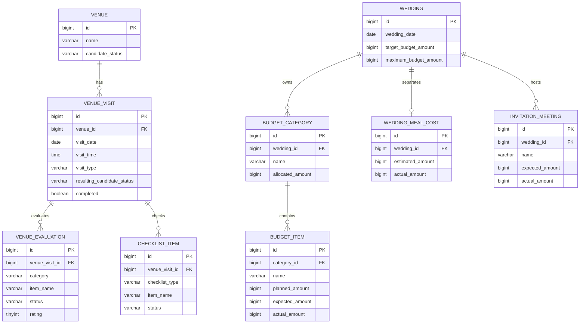

# Wedget Architecture

## 1. 설계 목표

Wedget은 실제 결혼 준비 과정에서 사용하는 개인용 웨딩 플래너다.

포트폴리오에서 설명 가능한 도메인 경계와 비즈니스 규칙을 우선하며, 초기에는 MSA가 아닌 **모듈형 모놀리스**로 개발한다.

현재 구현 우선순위는 다음과 같다.

1. 모바일 현장에서 사용하는 Venue Tour MVP
2. Wedding 설정과 본예산 관리
3. 청첩장 모임
4. Payment, Payer, Vendor, Quote 확장

Backend는 계산 결과의 Source of Truth다. Frontend는 입력 중 미리보기를 위해 같은 계산을 수행할 수 있지만, 저장 이후에는 Backend 응답을 기준으로 화면을 갱신한다.

---

## 2. 전체 구조

```text
React + TypeScript + Vite + PWA
              |
           REST API
              |
Spring Boot 3 Modular Monolith
              |
      Spring Data JPA
              |
            MySQL
```

```text
wedget/
├── backend/
├── frontend/
├── README.md
├── REQUIREMENTS.md
├── ARCHITECTURE.md
└── TASKS.md
```

Backend와 Frontend는 독립적으로 실행하고 빌드할 수 있어야 한다.

---

## 3. Backend 패키지 구조

최상위 패키지는 기술 계층이 아니라 기능으로 나눈다. 각 기능 내부에서 API, Application, Domain, Infrastructure 계층을 구분한다.

```text
com.wedget
├── common
│   ├── config
│   ├── exception
│   └── response
├── venue
│   ├── api
│   ├── application
│   ├── domain
│   └── infrastructure
├── wedding
│   ├── api
│   ├── application
│   ├── domain
│   └── infrastructure
├── budget
│   ├── api
│   ├── application
│   ├── domain
│   └── infrastructure
├── meal
│   ├── api
│   ├── application
│   ├── domain
│   └── infrastructure
├── invitation
│   ├── api
│   ├── application
│   ├── domain
│   └── infrastructure
└── dashboard
    ├── api
    └── application
```

- `api`: Controller, Request/Response DTO
- `application`: 유스케이스 조합, 트랜잭션 경계, 리소스 소속 검증
- `domain`: Entity, 값 타입, Enum, 핵심 계산 규칙
- `infrastructure`: JPA Repository와 조회 구현

`dashboard`는 여러 도메인의 결과를 조합하는 조회 기능이다. 독립 Entity를 만들지 않는다.

`payment`, `payer`, `vendor`, `quote`, `workspace` 패키지는 실제 기능을 구현하는 시점에 추가한다.

---

## 4. Frontend 구조

Frontend는 Wedget 전체 서비스가 공유하는 App Shell과 기능 모듈의 Route를 분리한다. 현재는 Venue Tour만 구현하며, 미래 기능은 구현 시점에 Route와 Navigation 항목을 추가한다.

```text
app/
├── layout.tsx                 # 전체 서비스 App Shell
├── components/               # 공통 Navigation과 Layout
├── lib/                      # API, 공통 타입과 저장소
└── venues/                   # Venue Tour 기능 Route
    ├── page.tsx
    ├── compare/page.tsx
    └── [venueId]/
        ├── page.tsx
        └── visits/new/page.tsx
```

- 최상위 기능 Route는 `/venues`, 향후 `/budget`, `/vendors`처럼 모듈 경계를 표현한다.
- 공통 App Shell은 브랜드, 최상위 Navigation, 사용자/Workspace Context를 담당한다.
- 기능 내부의 입력 상태와 화면은 해당 기능 모듈에 둔다.
- 아직 구현하지 않은 미래 기능은 Navigation에 비활성 메뉴로 미리 노출하지 않는다.
- Server State와 입력 중인 Form/UI State를 분리한다.
- 금액, 날짜, 별점 표시는 공통 Formatter를 사용한다.
- Venue 방문 입력 화면은 Mobile First로 설계한다.
- PWA 설치를 지원하지만 초기 MVP에서 복잡한 Offline Sync는 구현하지 않는다.

---

## 5. 핵심 Domain 관계

### 5.1 Venue Tour

```text
Venue
 └── 1:N VenueVisit
          ├── 1:N VenueEvaluation
          └── 1:N ChecklistItem
```

### 5.2 Wedding Budget

```text
Wedding
 ├── 1:N BudgetCategory
 │        └── 1:N BudgetItem
 ├── 1:0..1 WeddingMealCost
 └── 1:N InvitationMeeting
```

JPA 연관관계는 기본적으로 자식에서 부모를 참조하는 단방향 `ManyToOne`을 사용한다. 부모의 컬렉션이 도메인 행위에 반드시 필요한 경우가 아니라면 양방향 연관관계를 추가하지 않는다.

### 5.3 MVP ERD



---

## 6. Venue Tour Domain

### 6.1 Venue

Venue는 비교 대상인 웨딩홀 후보의 현재 상태를 관리한다.

주요 데이터:

- 이름, 주소, URL, 대표 전화번호, 메모
- 현재 후보 상태

Venue의 평균 점수, 최근 예상 비용, 최근 방문일, 방문 횟수는 저장하지 않고 Visit 데이터로부터 조회한다.

Phase 0은 로그인과 Wedding 생성보다 먼저 개발하므로 Venue에 임시 `Wedding`이나 `Workspace` FK를 두지 않는다. 단일 사용자 데이터로 시작하고, CoupleWorkspace 도입 시 `workspace_id`를 추가하는 명시적인 Migration을 수행한다.

### 6.2 VenueVisit

VenueVisit은 한 번의 방문에서 확인한 사실과 판단의 스냅샷이다. 새 방문은 이전 방문을 덮어쓰지 않는다.

주요 데이터:

- 방문 유형, 방문 날짜와 시간, 가격 정보 출처
- 좋았던 점, 아쉬운 점, 한줄 총평, 상세 총평
- 재방문 의향, 방문 완료 여부
- 방문 결과로 결정한 후보 상태
- 가격 스냅샷

Venue에도 현재 후보 상태가 있고 Visit에도 후보 상태가 필요한 이유는 역할이 다르기 때문이다.

- `Venue.candidateStatus`: 현재 상태
- `VenueVisit.resultingCandidateStatus`: 해당 방문 직후 판단의 기록

Visit 저장 시 `resultingCandidateStatus`가 있으면 Venue의 현재 상태를 함께 변경한다. 두 변경은 하나의 트랜잭션에서 수행한다.

가격 정보는 VenueVisit의 생명주기에 속하므로 MVP에서는 별도 Entity가 아닌 `VenuePrice` Embeddable 값 타입으로 둔다.

```text
VenuePrice
- baseAndMandatoryAmount
- pricePerGuest
- guaranteedGuestCount
- expectedGuestCount
- additionalAmount
- discountAmount
```

`estimatedMealAmount`와 `finalEstimatedAmount`는 파생값이므로 저장하지 않는다.

```text
appliedGuestCount = max(non-null guaranteedGuestCount, expectedGuestCount)
estimatedMealAmount = appliedGuestCount * pricePerGuest
finalEstimatedAmount
  = baseAndMandatoryAmount
  + estimatedMealAmount
  + additionalAmount
  - discountAmount
```

가격을 모르는 암행투어를 지원하기 위해 각 입력값과 계산 결과는 비어 있을 수 있다. 두 인원이 모두 비어 있으면 적용 인원은 `null`이다. 계산에 필요한 값이 부족하면 결과도 `null`로 반환하며 임의로 0원으로 간주하지 않는다.

### 6.3 VenueEvaluation

VenueEvaluation은 별점과 평가 이유를 함께 기록하는 주관적 평가다.

```text
VenueEvaluation
- venueVisitId
- category
- itemName
- status
- rating
- reason
- importance
- sortOrder
```

`EvaluationCategory`는 MVP에서 Enum으로 관리한다. 카테고리 수가 제한적이고 비교 화면의 열과 집계 기준이기 때문이다. 평가 항목명은 문자열 스냅샷으로 저장하여 사용자가 Visit별로 항목을 추가하거나 수정할 수 있게 한다.

상태는 다음처럼 명시적으로 구분한다.

- `UNRATED`: 아직 작성하지 않음
- `RATED`: 평가 완료, rating 필수
- `NOT_OBSERVED`: 의도적으로 미확인, rating 없음

이 구분은 작성 진행률과 평균 계산을 정확히 표현한다. `rating = null` 하나로 미작성과 미확인을 동시에 표현하지 않는다.

기본 평가 항목은 애플리케이션의 버전 관리된 Catalog로 제공한다. 초기 MVP에서는 Template 정의를 DB Entity로 만들지 않는다. Visit 생성 시 Catalog를 VenueEvaluation 스냅샷으로 복사한다.

### 6.4 ChecklistItem

Checklist는 객관적인 확인 여부를 기록하고, Evaluation은 1~5점의 주관적인 판단을 기록한다. 두 모델의 상태와 계산 방식이 다르므로 분리한다.

MVP에서는 별도 `Checklist` 또는 `ChecklistTemplate` Entity를 만들지 않는다. VenueVisit 아래에 `ChecklistItem`을 직접 둔다.

```text
ChecklistItem
- venueVisitId
- checklistType
- section
- itemName
- status
- answer
- note
- sortOrder
```

상태:

- `UNCHECKED`
- `CHECKED`
- `NOT_APPLICABLE`

암행투어와 실제 상담의 기본 항목은 버전 관리된 Catalog에서 복사한다. 사용자는 복사된 Item을 자유롭게 수정할 수 있다. 사용자 정의 Template 저장 기능은 실제 반복 사용 요구가 확인된 이후 추가한다.

### 6.5 Venue, Vendor, Quote 관계

- Venue는 사용자가 방문하고 평가하는 웨딩홀 후보다.
- Vendor는 계약 및 연락처를 관리하는 일반 업체다.
- Quote는 업체가 제시한 공식 견적의 버전이다.
- VenueVisit의 VenuePrice는 방문 당시 알고 있던 가격 스냅샷이다.

개념이 겹쳐 보여도 생명주기와 신뢰 수준이 다르므로 상속이나 단일 Entity로 합치지 않는다. Vendor/Quote 기능을 구현할 때 필요하면 Venue와 Vendor, VenueVisit과 Quote 사이에 선택적 참조를 추가한다.

### 6.6 Venue 점수와 비교

평균 점수는 저장하지 않고 `VenueScoreCalculator`가 계산한다.

```text
average = RATED 상태인 Evaluation의 rating 합 / RATED 항목 수
```

- `UNRATED`, `NOT_OBSERVED`는 평균에서 제외한다.
- 평가 완료 항목이 하나도 없으면 평균은 `null`이다.
- 기본 평균은 가중치를 적용하지 않는다.
- 가중치 계산은 MVP 이후 별도 정책으로 추가한다.

Venue 목록과 비교는 **가장 최근의 완료된 Visit**을 기준으로 한다. 최근 Visit은 `visitDate`, `visitTime`, `id` 내림차순으로 결정한다. 완료된 Visit이 없으면 비교 값은 `null`로 표시한다.

---

## 7. Wedding Budget Domain

### 7.1 Wedding

Wedding은 결혼식 날짜, 목표 예산, 최대 예산을 관리한다.

- D-Day는 날짜로부터 계산한다.
- 목표 예산과 최대 예산은 0보다 커야 한다.
- 최대 예산은 목표 예산보다 작을 수 없다.
- 전체 예상 비용, 실제 지출, 사용률은 저장하지 않는다.

### 7.2 BudgetCategory

저장 데이터:

- `weddingId`
- 이름
- 배정 예산
- 정렬 순서

목표 비율, 예상 비용 합계, 실제 지출 합계, 잔여 예산, 사용률, 예산 상태는 파생값이다.

### 7.3 BudgetItem

금액의 의미를 다음처럼 구분한다.

- `plannedAmount`: 항목에 책정한 예산
- `expectedAmount`: 견적 또는 계약을 바탕으로 예상되는 비용
- `actualAmount`: 현재까지 실제로 지출한 금액

중요도, 현재 결제 상태, 대표 결제 예정일, 결제자 유형, 선택적 Section, 비고, 정렬 순서를 함께 관리한다.

```text
variance = plannedAmount - expectedAmount
overBudget = expectedAmount > plannedAmount
```

### 7.4 WeddingMealCost

식대는 예식과 관련되지만 Wedding 본예산에서는 제외한다. 모든 예산 계산에 예외 조건을 넣는 대신 별도 모델로 관리한다.

MVP 저장 데이터:

- `weddingId`
- 예상 식대
- 실제 식대

향후 보증 인원, 예상/실제 참석 인원, 1인 식대를 추가한다.

### 7.5 Payment와 Payer

MVP에서는 별도 Entity를 만들지 않는다.

- 결제 상태와 대표 예정일은 BudgetItem에 저장한다.
- 결제자는 `PayerType` Enum으로 기록한다.
- `공동`은 분담 비율이 아니라 하나의 분류다.

계약금, 중도금, 잔금을 각각 관리할 때 `Payment`를 도입한다. 사용자 정의 결제자나 여러 사람의 분담이 필요할 때 `Payer`와 `ExpenseShare`를 도입한다.

---

## 8. 계산 책임

### Entity 또는 값 타입

자신의 데이터만 필요한 계산을 담당한다.

- BudgetItem 차액과 초과 여부
- VenuePrice 예상 식대와 최종 예상 비용
- InvitationMeeting 1인당 비용

### Domain Calculator

여러 Entity가 필요한 계산을 담당한다.

- `VenueScoreCalculator`: 방문 평균과 Category별 점수
- `BudgetCalculator`: Category 및 Wedding 예산 집계와 경고

### Application Service

- Repository에서 계산에 필요한 데이터를 조회한다.
- Calculator를 호출한다.
- 트랜잭션과 리소스 소속을 검증한다.
- Dashboard, Venue 목록, 비교 Response를 구성한다.

파생 계산값은 원칙적으로 DB에 저장하지 않는다. 조회 성능이 실제 문제로 확인되면 정의를 바꾸지 않고 조회 전용 Projection 또는 집계 쿼리로 최적화한다.

카테고리 배정 예산이 0원인 경우:

- 예상 비용도 0원: 사용률 0%, `NORMAL`
- 예상 비용이 0원보다 큼: 사용률 `null`, `OVER_BUDGET`

0으로 나누는 문제를 피하면서도 예산 초과를 숨기지 않는다.

---

## 9. 금액과 비율 타입

초기 서비스는 원화만 사용하므로 Java `long`, MySQL `BIGINT`로 원 단위 금액을 저장한다.

- 소수점이 필요하지 않는다.
- `double`의 부동소수점 오차를 피한다.
- 합계와 비교 규칙이 단순하다.

평균 점수와 사용률처럼 나눗셈이 필요한 값은 Java `BigDecimal`로 계산하며, 반올림 기준을 Calculator에 명시한다.

신혼여행 등 다중 통화 요구가 생기면 `Money(amount, currency)` 값 타입과 환율 기준을 별도 설계한다. MVP에 미리 도입하지 않는다.

---

## 10. REST API 원칙

- 버전을 포함한 `/api/v1` prefix를 사용한다.
- Entity를 직접 반환하지 않고 DTO를 사용한다.
- Wedding 하위 데이터는 Wedding 범위를 URI에 명시한다.
- Phase 0 Venue API는 단일 사용자 범위로 시작한다. Workspace 도입 후에는 인증된 사용자의 Workspace 범위를 서버가 적용하여 기존 URI를 유지한다.

### Venue Tour

```http
GET    /api/v1/venues
POST   /api/v1/venues
GET    /api/v1/venues/{venueId}
PATCH  /api/v1/venues/{venueId}

GET    /api/v1/venues/{venueId}/visits
POST   /api/v1/venues/{venueId}/visits
GET    /api/v1/venues/{venueId}/visits/{visitId}
PATCH  /api/v1/venues/{venueId}/visits/{visitId}

PUT    /api/v1/venues/{venueId}/visits/{visitId}/evaluations
PUT    /api/v1/venues/{venueId}/visits/{visitId}/checklist-items

GET    /api/v1/venues/compare?ids=1,2,3
```

현장 입력은 여러 평가와 체크리스트를 한 번에 저장할 수 있도록 일괄 갱신 API를 제공한다. 각 자식 Row마다 네트워크 요청을 보내지 않는다.

### Wedding과 Budget

```http
POST   /api/v1/weddings
GET    /api/v1/weddings/{weddingId}
PATCH  /api/v1/weddings/{weddingId}
GET    /api/v1/weddings/{weddingId}/dashboard

GET    /api/v1/weddings/{weddingId}/budget-categories
POST   /api/v1/weddings/{weddingId}/budget-categories
PATCH  /api/v1/weddings/{weddingId}/budget-categories/{categoryId}
DELETE /api/v1/weddings/{weddingId}/budget-categories/{categoryId}

POST   /api/v1/weddings/{weddingId}/budget-categories/{categoryId}/items
PATCH  /api/v1/weddings/{weddingId}/budget-items/{itemId}
DELETE /api/v1/weddings/{weddingId}/budget-items/{itemId}

GET    /api/v1/weddings/{weddingId}/meal-cost
PUT    /api/v1/weddings/{weddingId}/meal-cost

GET    /api/v1/weddings/{weddingId}/invitation-meetings
POST   /api/v1/weddings/{weddingId}/invitation-meetings
PATCH  /api/v1/weddings/{weddingId}/invitation-meetings/{meetingId}
DELETE /api/v1/weddings/{weddingId}/invitation-meetings/{meetingId}
```

경로의 `venueId`, `visitId`, `weddingId`, `categoryId` 조합은 실제 소속 관계와 일치하는지 검증한다.

---

## 11. 트랜잭션 경계

- Venue 생성/수정: Venue 하나
- VenueVisit 생성: Visit, 기본 Evaluation, 기본 ChecklistItem 생성
- VenueVisit 수정: Visit 수정과 resultingCandidateStatus에 따른 Venue 상태 반영
- Evaluation/Checklist 일괄 저장: 하나의 Visit 범위
- BudgetItem 생성/수정/삭제: Item 하나와 소속 검증
- Wedding 설정 변경: Wedding 하나
- Dashboard와 비교: 읽기 전용 트랜잭션

Controller는 트랜잭션을 시작하지 않는다. Application Service의 public 유스케이스를 트랜잭션 경계로 삼는다.

---

## 12. 삭제 정책

초기 MVP에서는 명시적인 Hard Delete를 사용한다. 모든 Entity에 일괄적인 Soft Delete를 도입하지 않는다.

- Venue에 Visit가 있으면 삭제를 거부한다.
- VenueVisit 삭제는 기본 API로 제공하지 않는다. 잘못 입력한 기록은 수정한다.
- BudgetCategory에 Item이 있으면 삭제를 거부한다.
- BudgetItem과 InvitationMeeting은 명시적인 요청으로 삭제할 수 있다.
- Wedding 삭제 API는 MVP에서 제공하지 않는다.

사용자 공동 관리나 감사 이력이 필요해지면 상태 기반 보관 또는 변경 이력을 별도 설계한다.

---

## 13. Seed Data 정책

다음 두 종류를 구분한다.

- 운영 기본 Catalog: Venue Evaluation, Checklist, Budget Category/Item 기본값
- 개발 샘플 데이터: Local/Dev profile에서만 생성하는 Venue와 방문 기록

운영 기본 Catalog는 코드 또는 버전 관리되는 Migration으로 관리한다. 애플리케이션을 재시작할 때 기존 사용자 데이터를 덮어쓰지 않는다.

---

## 14. MVP에서 의도적으로 미루는 기능

- Venue 평가 가중치
- DB 기반 사용자 정의 Template
- Venue 사진과 견적서 파일 첨부
- Offline Sync와 실시간 공동 편집
- Payment 회차별 관리와 실제 분담
- Vendor/Quote의 완전한 비교 UI
- 신혼여행 상세 예산과 다중 통화
- 복잡한 인증 및 권한
- 추천과 AI 기능

PWA 설치와 Responsive UI는 지원하되, Service Worker를 이용한 데이터 동기화는 구현하지 않는다.

---

## 15. 향후 확장 전략

### CoupleWorkspace

```text
User N:M CoupleWorkspace
        └── WorkspaceMember(role)
```

도입 시 Venue, Wedding 등 최상위 리소스에 `workspace_id`를 추가한다. 모든 조회와 수정은 인증 사용자의 Workspace 범위로 제한한다.

### Payment와 비용 분담

```text
BudgetItem 1:N Payment
Payment 1:N ExpenseShare
ExpenseShare N:1 Payer
```

### Vendor와 Quote

```text
Vendor 1:N Quote
Venue       0..1 Vendor reference
VenueVisit  0..1 Quote reference
```

참조는 선택적으로 추가하며 Venue 방문 기록의 과거 가격 스냅샷은 Quote가 변경되어도 유지한다.

---

## 16. 주요 Trade-off 요약

| 결정 | 선택 이유 | 감수하는 비용 |
|---|---|---|
| 모듈형 모놀리스 | 작은 팀과 포트폴리오에 적합, 경계 설명 가능 | 물리적 독립 배포 없음 |
| 기능별 패키지 | 도메인 응집도와 향후 모듈 분리에 유리 | 계층별 파일 탐색보다 초기 구조가 길어짐 |
| 파생값 비저장 | 정합성과 계산 규칙의 단일화 | 조회 시 계산 필요 |
| VenuePrice Embeddable | Visit 가격 스냅샷의 생명주기를 명확히 표현 | 가격만 독립 조회하기 어려움 |
| Evaluation과 Checklist 분리 | 주관적 점수와 객관적 확인 상태를 정확히 모델링 | 자식 모델이 두 종류가 됨 |
| Template Entity 보류 | Phase 0의 과도한 CRUD와 버전 문제 방지 | 사용자 정의 Template 저장 불가 |
| Evaluation Category Enum | 비교와 집계 기준 안정화 | 사용자 정의 Category는 후속 Migration 필요 |
| 원화 금액 `long` | 오차 없는 단순 계산 | 다중 통화 도입 시 모델 확장 필요 |
